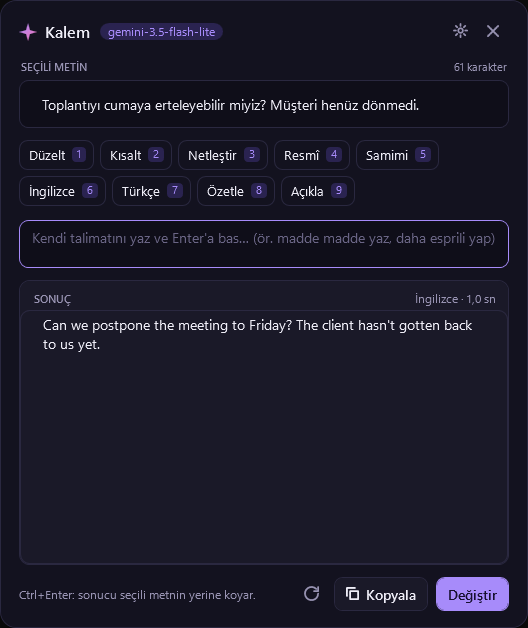

# Kalem

Windows için yapay zekâ destekli yazım asistanı. Herhangi bir uygulamada metni seç, **`Ctrl+Alt+Boşluk`** tuşlarına bas, bir işlem seç. Gemini Flash-Lite sonucu bir saniye içinde yazar, `Ctrl+Enter` ile seçtiğin metnin yerine koyar.



## İndir

**[Son sürümü indir (Kalem.exe)](https://github.com/Enskygr234/kalem/releases/latest)**

Tek dosya, kurulum yok. Windows 10/11 (64 bit). Açtığında sistem tepsisine yerleşir.

> Uygulama dijital olarak imzalı olmadığından Windows SmartScreen ilk açılışta uyarı gösterebilir: **Ek bilgi › Yine de çalıştır**.

### Gemini API anahtarı

Kalem, Google'ın Gemini API'sini **kendi anahtarınla** kullanır:

1. [aistudio.google.com/apikey](https://aistudio.google.com/apikey) adresinden Google hesabınla ücretsiz bir anahtar al.
2. Kalem'i ilk açtığında çıkan ayarlar ekranına yapıştır, **Bağlantıyı dene**, sonra **Kaydet**.

İstersen anahtarı `GEMINI_API_KEY` ortam değişkeniyle de verebilirsin.

## İşlemler

| Kısayol | İşlem | Ne yapar |
| --- | --- | --- |
| `Ctrl+1` | Düzelt | Yazım, noktalama ve dilbilgisi hatalarını düzeltir; üslubu korur |
| `Ctrl+2` | Kısalt | Anlamı koruyarak kısaltır |
| `Ctrl+3` | Netleştir | Daha açık ve akıcı hâle getirir |
| `Ctrl+4` | Resmî | Profesyonel bir üsluba çevirir |
| `Ctrl+5` | Samimi | Sıcak ve doğal bir üsluba çevirir |
| `Ctrl+6` | İngilizce | İngilizceye çevirir |
| `Ctrl+7` | Türkçe | Türkçeye çevirir |
| `Ctrl+8` | Özetle | Kısa maddelerle özetler |
| `Ctrl+9` | Açıkla | Ne anlatmak istediğini sade bir dille açıklar |

Ya da talimat kutusuna kendi isteğini yaz (*"madde madde yaz"*, *"daha esprili yap"*, *"e-posta olarak düzenle"*) ve `Enter`'a bas. Metin seçmeden açarsan doğrudan soru da sorabilirsin.

| Tuş | İşlev |
| --- | --- |
| `Ctrl+Alt+Boşluk` | Kalem'i aç (her yerden) |
| `Ctrl+Enter` | Sonucu seçili metnin yerine koy |
| `Ctrl+Shift+C` | Sonucu panoya kopyala |
| `Ctrl+R` | Tekrar üret |
| `Esc` | Üretimi durdur / kapat |

`Ctrl+Alt+Boşluk` başka bir program tarafından kullanılıyorsa Kalem otomatik olarak `Ctrl+Alt+K` ya da `Ctrl+Shift+K` kısayoluna geçer.

## Gizlilik ve güvenlik

- **Ne gönderilir:** Yalnızca sen bir işlem başlattığında, seçili metin ve talimatın Google Gemini API'sine gönderilir. Başka hiçbir yere veri gönderilmez; Kalem arka planda hiçbir şeyi okumaz.
- **API anahtarı** Windows DPAPI ile şifrelenip `%AppData%\Kalem\ayarlar.json` içinde saklanır; yalnızca senin Windows hesabın çözebilir. Dosyada düz metin olarak bulunmaz.
- **Panon korunur:** Seçili metni almak ve sonucu yapıştırmak için pano kısa süreliğine kullanılır, sonra önceki içeriği geri yüklenir.
- **Terminaller:** Terminallerde `Ctrl+C` çalışan programı durdurduğu için Kalem terminal pencerelerine (Windows Terminal, cmd, PowerShell …) hiç `Ctrl+C` göndermez; metni Kalem'e elle yapıştırabilirsin.
- Gemini API'nin ücretsiz katmanında Google, gönderilen içeriği ürünlerini geliştirmek için kullanabilir; hassas metinler için ücretli katmanı kullan. Ayrıntılar: [Gemini API şartları](https://ai.google.dev/gemini-api/terms).

## Model

Varsayılan model **`gemini-3.5-flash-lite`** (hızlı ve düşük maliyetli). Ayarlardaki **En yeniyi bul** düğmesi, anahtarının erişebildiği en yeni kararlı Flash-Lite modelini otomatik seçer; istersen başka bir Gemini modelinin adını da yazabilirsin.

## Kaynaktan derleme

[.NET 10 SDK](https://dotnet.microsoft.com/download) gerekir.

```powershell
dotnet run -c Release
dotnet publish -c Release -o publish
```

C# + WPF; tepsi simgesi için Windows Forms `NotifyIcon`. Gemini'ye REST (`streamGenerateContent`, SSE) ile bağlanır; ek kütüphane yok. Kod düzeni:

- `Gemini.cs`: API istemcisi, akış (streaming), hata mesajları, model seçimi
- `Settings.cs`: ayarlar ve DPAPI ile şifrelenmiş anahtar
- `Native.cs`: genel kısayol, `Ctrl+C` / `Ctrl+V` gönderme, terminal algılama
- `MainWindow.xaml(.cs)`: açılır pencere, işlemler, ayarlar ekranı, tepsi menüsü
